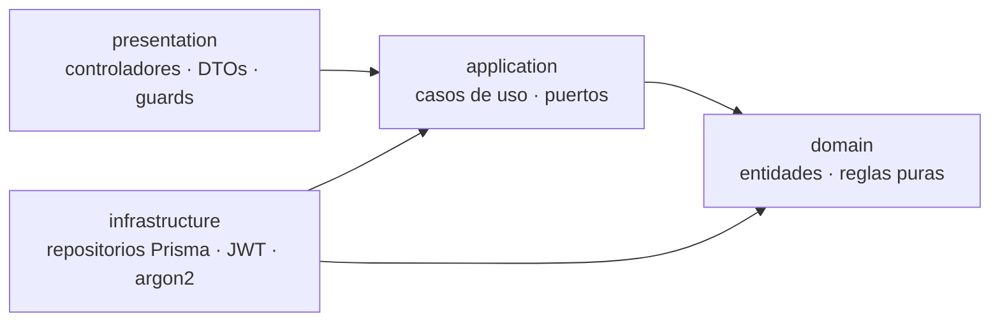
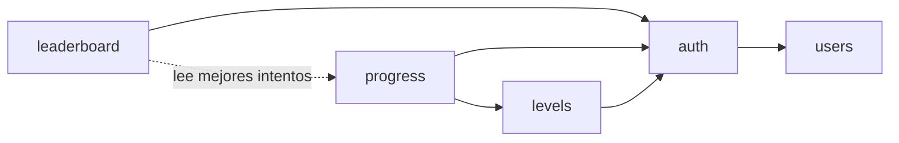
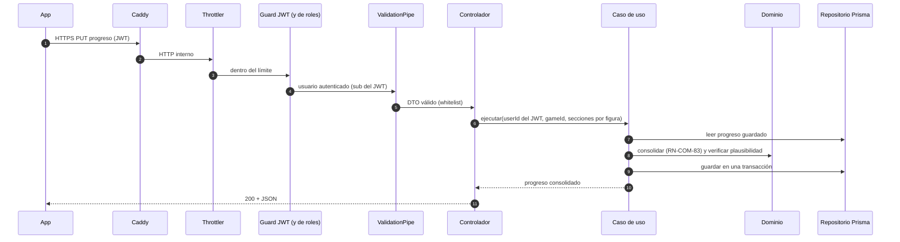
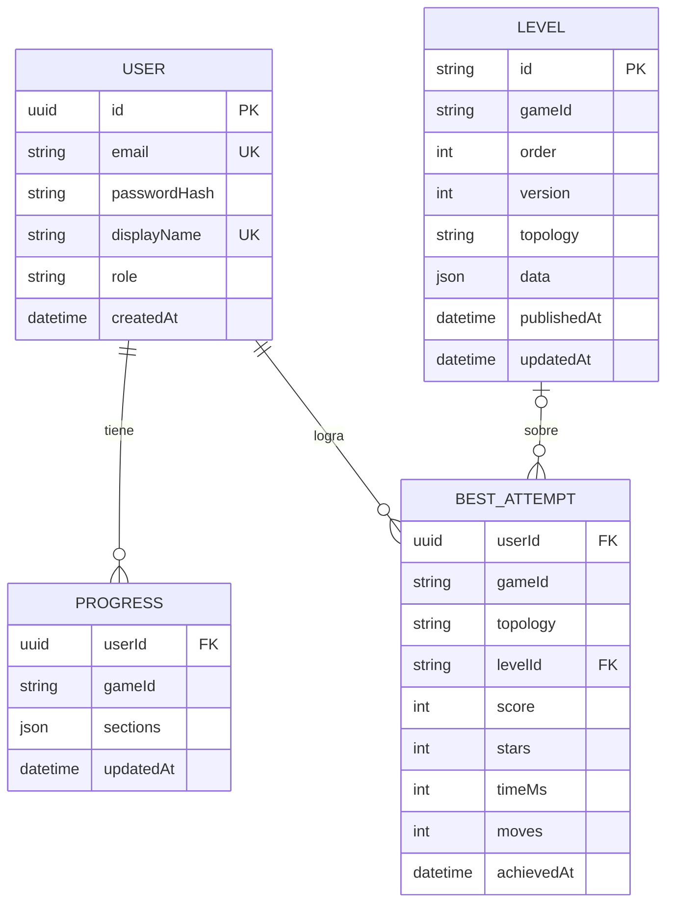

# ARQ-01 — Arquitectura general de la API

| Campo | Valor |
|---|---|
| Estado | Borrador para revisión del equipo (Paso 2) |
| Fecha | 2026-11-11 (revisión de coherencia: 12-11) |
| Repositorio | `hexablock-api` (`docs/architecture/ARQ-01-API-GENERAL.md`) |
| Relacionados | `ARQ-00-SISTEMA.md` (compartido), `ADR-001-tech-stack.md` §2.2–2.4, `03-REQUISITOS.md` (API), `SECURITY-BASELINE.md` §3–4 |

## 0. Alcance de este documento

**Decide:** módulos, capas dentro de cada módulo y sus dependencias, el recorrido de una petición, el modelo de datos a grandes rasgos, el despliegue y los controles de CI.

**No decide** (Paso 5, contratos): rutas y DTOs exactos (`openapi.yaml`), esquema Prisma definitivo, JSON Schema de los niveles.

**Estados:** ✅ ya decidido (ADR-001 o enunciado) · 🟡 propuesta para que el equipo confirme.

---

## 1. Qué tiene que cumplir esta arquitectura

| Requisito | Qué le exige a la arquitectura |
|---|---|
| RF-70 a 93 | Cuatro áreas: cuenta, progreso, ranking y niveles, más salud y documentación |
| RNF-12 (backend por capas) | La consolidación, los criterios de ranking y la validación de niveles son **dominio**: TypeScript puro, sin NestJS ni Prisma, que se prueba sin base de datos |
| ARQ-S-03 (consolidación dos veces) | La consolidación tiene que dar **exactamente** lo mismo que en la app → mismos ejemplos de prueba (E-COM-2, E-COM-3) |
| SEC-API-01 a 10 | Identidad desde el JWT, validación estricta, roles con denegación por defecto, rate limiting, errores sin stack |
| RNF-32, 36 (siempre desplegado) | Contenedor sin estado, migraciones al arrancar, `/health`, despliegue automático |

## 2. Capas dentro de cada módulo

Se aplica la misma idea de Clean que en la app, adaptada a NestJS. Cada módulo de negocio tiene cuatro carpetas:



| Carpeta | Capa Clean | Qué contiene | Puede importar |
|---|---|---|---|
| `domain/` | 1 · Entidades | Entidades y reglas puras: consolidación, criterios de mejor intento y de orden del ranking, validación estructural de niveles, plausibilidad | **Nada** de NestJS, Prisma ni otros módulos de infraestructura |
| `application/` | 2 · Casos de uso | Casos de uso (un servicio por caso) y **puertos** (interfaces de repositorio, hasher, emisor de tokens) | `domain/` |
| `presentation/` | 3 · Adaptadores (entrada) | Controladores, DTOs con `class-validator`, decoradores de Swagger, mappers DTO ↔ dominio | `application/`, `domain/`, NestJS |
| `infrastructure/` | 3 · Adaptadores (salida) | Clases que **implementan los puertos**: repositorios Prisma, hasher argon2, emisor JWT | Todo lo anterior, Prisma, librerías |

NestJS conecta los puertos con sus implementaciones por inyección de dependencias en el `*.module.ts` de cada módulo (el *composition root* del módulo).

**Capa 4 (frameworks):** `src/main.ts`, `src/prisma/` (`PrismaService`), los `*.module.ts` y la configuración de NestJS, PostgreSQL y Docker. Así cada carpeta corresponde a una sola capa del enunciado §3.4 (D-22).

## 3. Módulos

| Módulo | Responsabilidad | RF |
|---|---|---|
| `auth` | Registro, inicio de sesión, emisión y verificación del JWT, guard de autenticación, guard de roles | RF-70, RF-71 |
| `users` | Usuario, nombre visible y rol | RF-70 |
| `progress` | Recibir los resultados de una variante por figura (todos o solo los que cambiaron, D-49), consolidar, guardar el progreso y los mejores intentos; entregar el progreso de las 4 variantes; plausibilidad | RF-72, RF-93 |
| `leaderboard` | Ranking por `gameId`, figura (D-27) y por nivel, paginado, con la posición propia | RF-74 |
| `levels` | Listar niveles publicados; crear y actualizar (admin); validación estructural | RF-80, RF-81, RF-82 |
| `health` | `GET /health` (API + base de datos) | RF-92 |
| `common` | Filtro global de errores, pipe de validación, interceptor de accesos HTTP, throttler, configuración validada; aspectos AOP sobre los casos de uso en `common/application/aspects/` (D-42) | RF-91, SEC-API-04, 08, SEC-WEB-06 |
| `prisma` | `PrismaService` (conexión) | — |

**Dependencias entre módulos:** `progress` y `leaderboard` comparten los **mejores intentos** (`leaderboard` solo los lee). `levels` es independiente. Ningún módulo importa el `infrastructure/` de otro.



`progress` consulta `levels` para verificar que el nivel de un resultado existe (RN-COM-108).

## 4. Estructura del repositorio

```
hexablock-api/
├── src/
│   ├── main.ts                     # arranque: helmet, CORS, pipes, filtros, Swagger
│   ├── app.module.ts
│   ├── common/                     # filtros, pipes, interceptores, throttler, config
│   ├── prisma/
│   └── modules/
│       ├── auth/        {domain, application, presentation, infrastructure}
│       ├── users/       {domain, application, presentation, infrastructure}
│       ├── progress/    {domain, application, presentation, infrastructure}
│       ├── leaderboard/ {domain, application, presentation, infrastructure}
│       ├── levels/      {domain, application, presentation, infrastructure}
│       └── health/
├── prisma/
│   ├── schema.prisma
│   └── migrations/
├── test/
│   ├── unit/                       # dominio y casos de uso, sin base de datos
│   ├── e2e/                        # endpoints con Supertest contra Postgres
│   └── fixtures/                   # datos de prueba propios del backend
├── deploy/
│   ├── docker-compose.yml          # api + postgres + caddy (producción)
│   └── Caddyfile
├── Dockerfile                      # multi-stage
├── docker-compose.dev.yml          # api + postgres (desarrollo)
└── docs/
```

## 5. Recorrido de una petición



Si algo falla en cualquier punto, el **filtro global de errores** responde con `{ code, message, details }` y el código correcto (400, 401, 403, 404, 409, 429 o 500), sin stack trace (RF-91).

**Transversales con mecanismos de NestJS** (tubería HTTP). El AOP sobre los casos de uso se hace con clases decoradoras (D-42, `ARQ-03-API-DETALLE.md` §4):

| Necesidad | Mecanismo | Control |
|---|---|---|
| Registro de accesos HTTP (estado, duración, *correlation id*); el registro de cada caso de uso, con redacción, lo hace `LoggingAspect` | Interceptor de acceso global | SEC-WEB-06 |
| Errores uniformes | Filtro de excepciones global | SEC-API-08, SEC-WEB-07 |
| Autenticación y roles | Guards (denegación por defecto) | SEC-API-02, 05 |
| Validación de entrada | `ValidationPipe` global | SEC-API-03 |
| Límite de peticiones | `@nestjs/throttler` | SEC-API-04 |

## 6. Modelo de datos (preliminar)

El esquema definitivo se fija en el Paso 5. Esta es la forma que se propone:



| Decisión | Motivo |
|---|---|
| `PROGRESS`: **una fila por `userId` + `gameId`** (clave), con una **sección por figura** dentro del JSON `sections` (D-27). Cada sección tiene una de dos formas: récord o niveles (D-45) | Cumple al pie de la letra el enunciado §5.2 ("una entrada de progreso por usuario y por variante"). El servidor no necesita consultar el JSON por dentro: el ranking sale de `BEST_ATTEMPT` |
| `BEST_ATTEMPT` en una tabla con columnas (no JSON), con la columna `topology` | El ranking necesita **ordenar y paginar** por estrellas, tiempo, movimientos y puntaje con índices. Para las variantes sin fin, `levelId` es nulo y cuenta solo el puntaje |
| `LEVEL.updatedAt` con un índice (`gameId`, `topology`, `updatedAt`, `id`) | La descarga por cambios ordena y pagina por esa clave; el cursor la codifica (D-48, RN-COM-77) |
| `LEVEL.data` como JSON + columnas comunes | Esquema común + sección específica por `gameId` (RN-COM-70) |

## 7. Despliegue

| Aspecto | Decisión |
|---|---|
| Imagen | `Dockerfile` multi-stage; la imagen final solo tiene el código compilado y las dependencias de producción |
| Producción | `deploy/docker-compose.yml` en EC2: `caddy` (80/443) → `api` (red interna) → `postgres` (red interna, volumen persistente) |
| Arranque | `prisma migrate deploy` y después la API; `restart: unless-stopped`; *healthcheck* sobre `/health` |
| Configuración | Variables de entorno validadas al arrancar (si falta `JWT_SECRET` o `DATABASE_URL`, la API no arranca) |
| CI/CD | PR: lint + unitarias + e2e con Postgres + contrato. Merge a `main`: imagen → GHCR → EC2 por SSH desde el Environment `production` → prueba de humo de `/health` (TEC-10) |
| Monitoreo | Workflow programado que consulta `/health` cada hora (RNF-32) |

## 8. Controles automáticos en CI

| Control | Cómo | Requisito |
|---|---|---|
| `domain/` no importa NestJS ni Prisma | Regla de ESLint `no-restricted-imports` aplicada a `src/modules/*/domain/**` | RNF-12 |
| `application/` no importa `infrastructure/` | Misma regla para `src/modules/*/application/**` | RNF-12 |
| Sin SQL inseguro | Búsqueda de `$queryRawUnsafe` | SEC-WEB-05 |
| Respuestas según el contrato | Pruebas de contrato contra `openapi.yaml` | RNF-25 |
| Consolidación idéntica a la de la app | Pruebas con los ejemplos compartidos de `docs/contracts/` | ARQ-S-03, D-23 |
| Dependencias seguras | `npm audit --audit-level=high` | SEC-WEB-02 |

## 9. Decisiones de este documento

| ID | Decisión | Estado |
|---|---|---|
| ARQ-B-01 | Módulos por área de negocio, cada uno con `domain`, `application`, `presentation` e `infrastructure` | ✅ D-22 (17-11) |
| ARQ-B-02 | Un servicio por caso de uso (no servicios "gigantes" por módulo) | ✅ D-22 (17-11) |
| ARQ-B-03 | El progreso se guarda como JSON, en una fila por usuario y `gameId` con una sección por figura (D-27); el contenido tiene una de dos formas, récord o niveles (D-45); los mejores intentos van en una tabla con columnas para el ranking | ✅ D-27, D-45 (19-11) |
| ARQ-B-04 | El AOP sobre los casos de uso se hace con **clases decoradoras** (registro, métricas, caché del ranking); los mecanismos de NestJS (guards, filtros, pipes, throttler, interceptor de acceso) quedan para la tubería HTTP | ✅ D-42 (19-11) |
| ARQ-B-05 | Los ejemplos compartidos (E-COM-2, E-COM-3, E-HF-NIVEL) y `openapi.yaml` viven en `docs/contracts/`, la fuente única; las pruebas del backend los leen de ahí y la app usa una copia verificada por su CI | ✅ D-23 (17-11) |
| ARQ-B-06 | La API no tiene estado: toda la información vive en PostgreSQL | ✅ |
