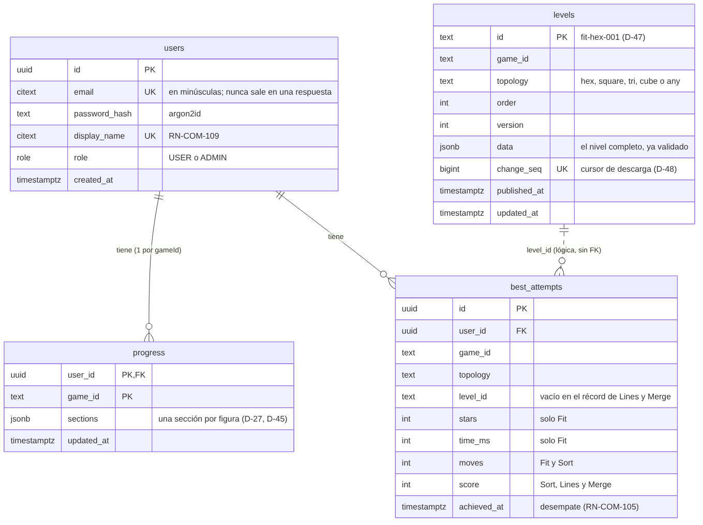

# ARQ-04 — Modelo de datos del servidor (Paso 5)

| Campo | Valor |
|---|---|
| Estado | Borrador para revisión del equipo, basado en D-27, D-45, D-47 a D-50 |
| Fecha | 2026-11-19 |
| Repositorio | `hexablock-api` (`docs/architecture/ARQ-04-API-DATOS.md`) |
| Parte de | `ARQ-01-API-GENERAL.md` §6 (resumen) y `ARQ-03-API-DETALLE.md` (puertos) |
| Contrato | `docs/contracts/` (`openapi.yaml` y esquemas JSON) |
| Diagrama | `docs/diagrams/datos.mmd` → `datos.png` |

## 1. Tablas



| Tabla | Una fila por | Para qué |
|---|---|---|
| `users` | cuenta | Correo y nombre visible únicos sin distinguir mayúsculas (`citext`); contraseña con argon2id (SEC-WEB-04); rol `USER` o `ADMIN` (el admin inicial sale de un *seed*, SEC-API-05) |
| `progress` | usuario y `gameId` | La "entrada de progreso por usuario y por variante" del enunciado §5.2 (D-27). `sections` es el JSON de `progress.schema.json`: una sección por figura, con forma `highScore` o `levels` (D-45) |
| `best_attempts` | usuario, `gameId`, figura y nivel | El mejor intento con columnas, para ordenar el ranking sin abrir el JSON. El récord de Lines y Merge usa `level_id = ''` (vacío) para que la clave única funcione: en PostgreSQL dos `NULL` no chocan |
| `levels` | nivel | El nivel completo y validado en `data`; `change_seq` es el orden de cambio que codifica el cursor de descarga (D-48) |

## 2. Esquema Prisma (borrador)

```prisma
generator client {
  provider = "prisma-client-js"
}

datasource db {
  provider   = "postgresql"
  url        = env("DATABASE_URL")
  extensions = [citext]
}

enum Role {
  USER
  ADMIN
}

model User {
  id           String        @id @default(uuid()) @db.Uuid
  email        String        @unique @db.Citext
  passwordHash String        @map("password_hash")
  displayName  String        @unique @map("display_name") @db.Citext
  role         Role          @default(USER)
  createdAt    DateTime      @default(now()) @map("created_at") @db.Timestamptz(3)
  progress     Progress[]
  bestAttempts BestAttempt[]

  @@map("users")
}

model Progress {
  userId    String   @map("user_id") @db.Uuid
  gameId    String   @map("game_id")
  sections  Json
  updatedAt DateTime @updatedAt @map("updated_at") @db.Timestamptz(3)
  user      User     @relation(fields: [userId], references: [id], onDelete: Cascade)

  @@id([userId, gameId])
  @@map("progress")
}

model BestAttempt {
  id         String   @id @default(uuid()) @db.Uuid
  userId     String   @map("user_id") @db.Uuid
  gameId     String   @map("game_id")
  topology   String
  levelId    String   @default("") @map("level_id")
  stars      Int?
  timeMs     Int?     @map("time_ms")
  moves      Int?
  score      Int?
  achievedAt DateTime @map("achieved_at") @db.Timestamptz(3)
  user       User     @relation(fields: [userId], references: [id], onDelete: Cascade)

  @@unique([userId, gameId, topology, levelId])
  @@index([gameId, topology, levelId])
  @@map("best_attempts")
}

model Level {
  id          String   @id
  gameId      String   @map("game_id")
  topology    String
  order       Int
  version     Int
  data        Json
  changeSeq   BigInt   @unique @map("change_seq")
  publishedAt DateTime @default(now()) @map("published_at") @db.Timestamptz(3)
  updatedAt   DateTime @updatedAt @map("updated_at") @db.Timestamptz(3)

  @@index([gameId, topology, changeSeq])
  @@map("levels")
}
```

Notas:
- `change_seq` toma su valor de una secuencia de PostgreSQL (`levels_change_seq`) en cada `INSERT` y `UPDATE`. Se crea en la migración con SQL, porque Prisma no asigna una secuencia en un `UPDATE`.
- `gameId` y `topology` son `text` y no `enum` de PostgreSQL. La lista cerrada vive en el contrato (`common.schema.json`) y la valida el `ValidationPipe`. Así, agregar una variante o una figura no exige una migración (EXTENSIBILITY.md).
- Ninguna consulta de un usuario usa un id que venga de la URL o del cuerpo. El `userId` siempre sale del `sub` del JWT (SEC-API-01).

## 3. Sincronizar el progreso (`PUT /v1/me/progress/{gameId}`)

Todo ocurre en **una transacción** (`SyncProgressUseCase`):

1. Se valida el cuerpo contra `progressUpdate`. Además se revisa que la forma de cada sección corresponda al `gameId` de la ruta (`highScore` para Lines y Merge, `levels` con intentos de Fit o de Sort) → si no, `400 validation-failed`.
2. **Plausibilidad (RN-COM-108):**
   - cada `levelId` existe y es de ese `gameId` y de esa figura (o `any`, en Sort). La API conoce también los 25 niveles incluidos en el APK porque el *seed* los publica (D-61, §5);
   - las estrellas están entre 1 y 3;
   - el puntaje está entre 0 y el tope de la variante (configurable);
   - `achievedAt` no está en el futuro (con 5 minutos de tolerancia por relojes desfasados).

   Si algo falla → `400 implausible-result`, y no se guarda nada.
3. `SELECT … FROM progress WHERE user_id = $1 AND game_id = $2 FOR UPDATE`. El bloqueo de la fila evita que dos teléfonos del mismo usuario, sincronizando a la vez, se pisen. Igualmente sería seguro reintentar, porque la consolidación da lo mismo sin importar el orden (RN-COM-84).
4. Se consolida sección por sección con lo recibido (RN-COM-83): unión de niveles, máximo del récord y mejor intento según el criterio de la variante. El empate final lo gana el `achievedAt` más antiguo.
5. `UPSERT` de la fila de `progress` y de cada fila de `best_attempts` que cambió.
6. Se responde el valor consolidado de **lo que se envió** (D-49).

`GET /v1/me/progress` lee las filas de `progress` del usuario. Las secciones salen tal cual están guardadas.

## 4. Ranking (`GET /v1/leaderboard/{gameId}`)

Todas las consultas filtran por `game_id` y `topology`. El orden final siempre se desempata por `achieved_at` y, al final, por `user_id`, así las posiciones son únicas y estables.

| Tipo | Filas | Orden |
|---|---|---|
| `highScore` (Lines, Merge) | `level_id = ''` | `score DESC, achieved_at ASC` (RN-COM-101, 105) |
| `fitLevel` | `level_id = $levelId` | `stars DESC, time_ms ASC, moves ASC, achieved_at ASC` (RN-COM-102, 105) |
| `sortLevel` | `level_id = $levelId` | `moves ASC, score DESC, achieved_at ASC` (RN-COM-103, 105) |
| `levelsGlobal` (Fit, Sort sin `levelId`) | `GROUP BY user_id` | `count(*) DESC`, `sum(stars) DESC` (solo Fit), `max(achieved_at) ASC` (RN-COM-104, 105) |

- La página usa `LIMIT`/`OFFSET` (D-46).
- La posición propia (`me`) se calcula con `ROW_NUMBER() OVER (…)` sobre el mismo orden, solo si llegó un token válido.
- Se une con `users` **solo** para traer `display_name`; el correo nunca entra en la consulta (SEC-API-03).
- El resultado se guarda en caché 30 segundos (D-42).

Para el tamaño del proyecto basta el índice `(game_id, topology, level_id)`. Con muchos jugadores se agregaría un índice por cada orden de la tabla.

## 5. Niveles (`GET /v1/levels`, `POST`, `PUT /v1/levels/{id}`)

- **Cursor (D-48, RN-COM-77):** es el último `change_seq` entregado, codificado en base64url. La consulta es `WHERE game_id = $1 AND topology IN ($2, 'any') AND change_seq > $cursor ORDER BY change_seq LIMIT $limit`. `'any'` solo cuenta para Hexa Sort. Sin cursor se empieza desde 0. La respuesta siempre trae `nextCursor`: el último `change_seq` de la página, o el mismo cursor si no hubo cambios.
- **Por qué una secuencia y no la fecha:** dos cambios en el mismo milisegundo tendrían la misma fecha; la secuencia nunca se repite. Un riesgo conocido de los cursores es que una transacción que tomó un número menor confirme después de que alguien ya leyó uno mayor. Aquí es despreciable, porque solo el administrador publica y lo hace de a uno.
- **Publicar:** el nivel pasa por el esquema y por las reglas estructurales (D-19, RN-COM-76); la geométrica la revisa antes el validador de la app.
  - `POST` con un `id` existente → `409 level-exists`.
  - `PUT` con una `version` que no es mayor → `409 stale-version`.
  - El `id` del cuerpo distinto del de la ruta → `400 validation-failed`.
- **No hay borrado.** Un nivel publicado solo se actualiza (RN-COM-73, 74).
- **Niveles incluidos en el APK (D-61):** la fuente es `hexablock-app/app/assets/levels/`. La API guarda una copia en `prisma/seed/levels/`; el *seed* los valida con las mismas reglas estructurales y los publica con `version` del archivo (un `UPSERT` que no baja la versión). El CI de la API compara la copia con la del repo de la app y falla si difieren, como el contrato (D-23) pero al revés.

## 6. Seguridad de los datos

| Riesgo | Medida |
|---|---|
| Robo de la base | Contraseñas con argon2id; ningún token se guarda (D-44: JWT sin refresh); correos solo en `users` |
| Enumeración por el ranking | El ranking solo expone `display_name`, que ya es público (RN-COM-106, 109) |
| Inyección | Prisma parametriza todo; las consultas con `ROW_NUMBER` usan `$queryRaw` con parámetros, nunca texto concatenado |
| Errores que filtran el esquema | El filtro global traduce los errores de Prisma (por ejemplo, `P2002` de clave única) a `409` o `500` sin nombres de tablas ni columnas (D-51, CWE-209) |
| Borrado de cuenta | `onDelete: Cascade` en `progress` y `best_attempts`. El endpoint de borrado no es parte del alcance; la cascada deja preparado el modelo |
